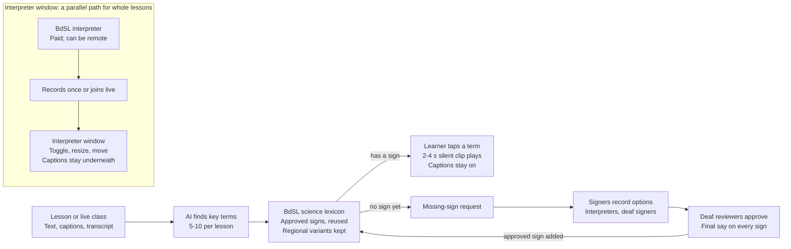
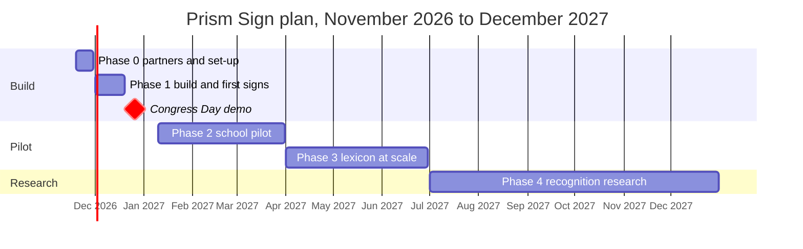

# Prism Sign — Project Plan for Bangla Sign Language Access

As of 2026-11-19. Shared, editable version: [Prism Sign project plan](https://claude.ai/artifact/XnXL8JqwL6rXoqvsBjh2pz).

## Build status

Phase 1 is built in Prism (see [architecture.md](architecture.md#prism-sign)). Prism now contains only this plan's features:

- **Sign glossary:** teachers add lessons; AI or teachers set each lesson's key terms in English, Bangla and Malay. Approved clips are linked in lesson text and in live captions and transcripts.
- **Interpreter window:** recorded interpreter videos per lesson, and a live **interpreter** role in the live class. Learners can switch the window on and off, resize it and move it, and the choice is remembered. Captions stay on.
- **Community lexicon:** the Sign glossary page has lesson terms, a deaf review queue (named reviewers, approve or reject), missing signs and the lexicon. Signers name themselves, consent per clip and can withdraw a clip. Regional variants are kept side by side.
- **Existing signs first:** missing-sign requests show when the IsharaKotha word list already documents the word. A 3D signer previews each documented sign from its description (Sign dictionary and Practise), labelled as software and not reviewed, until a person records it.

Next: recognising signs from their written description, without a large video dataset. See [sign-recognition-plan.md](sign-recognition-plan.md).

Not built yet: **sign as an adaptive layer** (part 4 below). Prism's adaptive lessons, simplified text and study dashboard were removed to keep Prism to this plan, so part 4 and the per-child comprehension comparison need to be rebuilt for the Phase 2 pilot. Phase 0 work (partners, licences, interpreter rates, pilot schools) is still open, and there are no real signed clips yet.

## Summary

**Prism Sign gives deaf learners in Bangladesh the same lesson in Bangla Sign Language (BdSL), starting with the words they miss most: the key science terms of each lesson.** Human signers come first, because deaf communities do not yet trust signing avatars. A 3D preview fills the gap only for documented signs nobody has recorded yet, and says so.

It is built in three layers:

- **Lesson sign glossary:** short clips of each lesson's key terms, recorded by interpreters and approved by deaf reviewers, then linked to every place the word appears in captions, transcripts and text.
- **Interpreter window:** a sign interpreter shown as a small video window over recorded lessons and live classes, which students can switch on and off.
- **Community lexicon:** when a term has no sign yet, Prism asks the deaf community for one, and the agreed sign is reused in every lesson.

AI does the routine work: finding a lesson's key terms, checking which have signs, and linking the clips. People do the signing and approve every sign.

The first milestone is a working demo on Congress Day, 2026-12-26, followed by a pilot in deaf schools from January to June 2027.

## Problem statement

**Bangla Sign Language is legally recognised, but deaf children still learn mainly through speech and print they cannot fully access.** Classroom content, especially science vocabulary, rarely reaches them in sign.

- **Scale:** a 2013 national survey found disabling hearing loss in 9.6% of people surveyed, higher in rural areas ([The Business Standard, 2026](https://www.tbsnews.net/features/when-silence-has-language-1548956); [Monash University](https://www.monash.edu/news/articles/signs-of-emotion-empowering-deaf-people-in-bangladesh-with-mental-wellbeing-sign-language)).
- **Law versus practice:** the Rights and Protection of Persons with Disabilities Act 2013 recognises the right to use BdSL as a first language ([TBS](https://www.tbsnews.net/features/when-silence-has-language-1548956)). BdSL has been an official language since 2009 ([Khan, 2026](https://www.reed.edu/linguistics/khan/assets/FASALproc2026.pdf)). Yet deaf schools in the region were historically oralist, and deaf adults ask for early education in BdSL, "not just oralist methods of lipreading and speech therapy" ([Khan, 2026](https://www.reed.edu/linguistics/khan/assets/FASALproc2026.pdf)).
- **Missing vocabulary:** BdSL has a dictionary (1994) and a digital e-dictionary (UNDP, 2024) ([Khan, 2026](https://www.reed.edu/linguistics/khan/assets/FASALproc2026.pdf); [UNDP](https://www.undp.org/bangladesh/press-releases/undp-launches-sign-language-e-dictionary-international-mother-language-day)). Specialist domains still lack signs: a 2025 project had to co-design new signs just for mental health terms ([Hasan et al.](https://pubmed.ncbi.nlm.nih.gov/41349569/)). Science lessons face the same gap.
- **Few signed resources:** Sesame Workshop's *Sisimpur* added sign language to 13 episodes in 2024, described as the first Bangladeshi children's show to do so ([TBS](https://www.tbsnews.net/features/when-silence-has-language-1548956)).
- **Technology is not ready to sign for us:** the largest public word-level BdSL dataset covers 60 words, recognised with up to 75.1% accuracy ([Rubaiyeat et al., 2025](https://consensus.app/papers/details/w:6286c27f-a544-42dc-8510-0135c93bd898/)).

**Problem in one line:** a deaf child in a Bangladeshi classroom cannot get the lesson's key concepts in their first language, because there are too few interpreters, too few signs for subject terms, and no tool that puts the signs that do exist where the child is reading.

Open question: no reliable published count of trained BdSL interpreters was found. Partners should supply it in Phase 0.

## What the research says

Sign and captions work best together, controlled by the learner, made by people. Each finding below sets one design rule.

| Finding | Design rule for Prism Sign |
| --- | --- |
| Captions added to sign interpreter video raised comprehension by 24% for deaf and 42% for hard-of-hearing viewers ([Debevc et al., 2015](https://consensus.app/papers/details/w:723f19e3-1f55-45a8-81f0-3b5a6db4520e/)) | Always show captions and sign together; never replace one with the other |
| Captions alone worked best for factual content; sign alone worked best for step-by-step content ([Almalhy, 2022](https://consensus.app/papers/details/w:5d3b756c-60a3-4bf0-8cd9-69276bb3bef9/)) | Glossary signs for concepts; the interpreter window for procedures and experiments |
| A sign interpreter that viewers can switch on and off rated above average for usability, and the best size and position depended on the content ([Boudreault et al., 2024](https://consensus.app/papers/details/w:a6cf983b-0e27-4eb2-a8b0-4c9752d775bd/)) | The interpreter window can be toggled, resized and moved, and the setting is remembered per learner |
| Deaf community members worried about avatar realism and cost, and about unfamiliar concepts that need deaf relay interpreters ([Coy et al., 2024](https://consensus.app/papers/details/w:4e183a63-3ccd-40e1-87ad-247b4f41c008/)) | No avatars. Real signers record clips, and deaf reviewers approve every sign |
| Co-designing domain signs with deaf people and interpreters filled real gaps for mental health terms in BdSL ([Hasan et al., 2025](https://pubmed.ncbi.nlm.nih.gov/41349569/)) | A missing-sign process led by the deaf community, using the same co-design method for science terms |
| BdSL recognition data is small: 60 words in the largest word-level set ([Rubaiyeat et al., 2025](https://consensus.app/papers/details/w:6286c27f-a544-42dc-8510-0135c93bd898/)) | Recognising students' own signing is a later research phase, not a launch feature. Prism's approved clips can become consented training data |

## Solution

**Prism Sign has four parts.** It builds on Prism's live class and captions, and applies the idea of Prism's fidelity gate (nothing reaches learners unchecked) to sign.

### 1. Lesson sign glossary (launch feature)

- When a teacher adds a lesson, AI lists its 5–10 key terms (for example "chlorophyll", "evaporation").
- Every term with an approved sign is underlined wherever it appears: lesson text, captions and transcript. Tapping it plays a 2–4 second looping clip.
- Clips are short and silent, so they work on phones and weak connections.

### 2. Interpreter window

- **Recorded lessons:** an interpreter records a signed version once, and it plays in sync as a small video window.
- **Live class:** an interpreter, who can be in another city, joins with a new **interpreter** role and is streamed as a second video.
- Students can switch the window on and off, resize it and move it. Captions stay on underneath.

### 3. Community BdSL science lexicon

- A key term without a sign becomes a **missing-sign request**.
- Interpreters or deaf signers record proposals. Deaf reviewers approve one, which is Prism's fidelity gate applied to sign.
- Approved signs go into a shared lexicon that every lesson reuses. Regional variants are stored side by side, never overwritten.
- Signers give consent for each clip, and the licence is set with the deaf partners before launch.

### 4. Sign as an adaptive layer (not built yet)

- For deaf and hard-of-hearing learners, **sign glossary** and **interpreter** become supports an adaptive lesson can choose, one short part at a time with a comprehension question.
- Prism then measures whether sign raises each child's comprehension, instead of assuming it does.

### Not in scope

- **Automatic text-to-sign translation, or avatars that replace human signers.** Communities don't yet trust them and the data is too small. The 3D preview only replays documented word signs and is labelled as such.
- **Recognising a student's signing,** for example to answer questions. This is a research phase from July 2027, built on consented clips.
- **Replacing interpreters.** Prism makes each interpreter reach more students and reuses their work.

## How it works

Every sign reaches learners only after deaf reviewers approve it.

The top loop grows the lexicon. Terms that already have a sign reach the learner straight away, and missing ones go to signers and then to deaf reviewers. The bottom path adds a full interpreter for whole lessons.

## Roadmap

A working demo on Congress Day, then a school pilot and lexicon build to June 2027.

| Phase | Deliverable | Gate to move on |
| --- | --- | --- |
| 0. Partners, set-up | Deaf partner and interpreters signed up; 3 pilot lessons and their key terms chosen | A deaf partner has agreed to review signs |
| 1. Build, first signs | Sign glossary, interpreter window and missing-sign queue in Prism; first approved clips for the 3 lessons | Every key term in one lesson has an approved sign |
| Congress Day demo | A deaf learner follows one lesson with captions, glossary signs and the interpreter window | Demo runs on a phone over mobile data |
| 2. School pilot | 1–2 deaf schools use Prism Sign weekly; study with and without sign | Consent in place; baseline scores recorded |
| 3. Lexicon at scale | Community proposals and deaf review running without the core team; first evaluation report | Key-term coverage target met |
| 4. Recognition research | Study whether consented clips can train recognition of students' signing | Only if deaf partners agree to the data use |

## How success is measured

The main measure is comprehension: deaf learners should understand a lesson as well as hearing classmates. Each child alternates lessons with captions only, captions plus the sign glossary, and captions plus the interpreter, so each child is compared with themselves.

| Metric | How it is measured | Target |
| --- | --- | --- |
| Comprehension gain | Chunk-question scores with sign vs captions only, per child | Above zero for most pilot learners |
| Gap to hearing peers | Score gap between deaf and hearing classmates on the same lesson | Shrinks with Prism Sign |
| Key-term coverage | Share of each pilot lesson's key terms that have an approved sign | 90% by the end of the pilot |
| Lexicon size | Approved science signs in the lexicon | Set with partners in Phase 0 |
| Time to a new sign | Days from missing-sign request to approved clip | Set from the first 20 requests |
| Deaf approval | Share of proposed signs that deaf reviewers approve on the first round | Reported; a low share means more co-design |
| Use | Sign taps per learner per lesson; interpreter window switched on | Reported |
| Reach | Data used per clip on a phone | Small enough for a weak mobile connection |
| Satisfaction | Rating by deaf learners, in BdSL with a facilitator | 4 of 5 or higher |

Targets marked "set" are fixed only after a baseline, not guessed now.

## Partners, team and costs

Deaf people lead the sign work. Prism provides the software, and partners provide signers, reviewers and schools.

**Partners to approach in Phase 0**

| Partner | Why | Ask |
| --- | --- | --- |
| SDSL (full name to confirm) | Partnered with Sesame Workshop to sign *Sisimpur* ([TBS](https://www.tbsnews.net/features/when-silence-has-language-1548956)) | Deaf reviewers, signers, co-design sessions |
| UNDP Bangladesh | Launched the BdSL e-dictionary in 2024 ([UNDP](https://www.undp.org/bangladesh/press-releases/undp-launches-sign-language-e-dictionary-international-mother-language-day)) | Licence to link or reuse existing signs, so none are duplicated |
| Monash Action Lab and co-authors | Built the Bangla mental health sign bank with deaf co-designers ([Monash](https://www.monash.edu/news/articles/signs-of-emotion-empowering-deaf-people-in-bangladesh-with-mental-wellbeing-sign-language)) | Method advice for co-designing science signs |
| BdSLW60 research team | Largest word-level BdSL dataset ([Rubaiyeat et al.](https://consensus.app/papers/details/w:6286c27f-a544-42dc-8510-0135c93bd898/)) | Research partner for the later recognition phase |
| Deaf schools (one or two) | Pilot classrooms | Teachers, learners, consent and study time |

**Team roles**

- Product and engineering: the current Prism team.
- Deaf co-designers and reviewers, paid for their time.
- BdSL interpreters, paid per recorded clip and per live hour.
- A school liaison for consent, scheduling and the study.

**Cost items:** interpreter and deaf-reviewer fees, video storage and delivery, AI calls for key-term extraction, recording kits (phone and tripod), and school-visit travel. Amounts depend on partner rates and should be budgeted in Phase 0.

## Risks and open questions

| Risk | Mitigation |
| --- | --- |
| Signs coined for science terms clash with signs the community already uses | Deaf reviewers approve every sign; check the UNDP e-dictionary first; keep regional variants |
| Regional and school-based variation in BdSL ([Khan, 2026](https://www.reed.edu/linguistics/khan/assets/FASALproc2026.pdf)) | Store variants side by side; each school picks its default |
| Interpreters are scarce and busy | Record each sign once and reuse it everywhere; interpreters join live classes remotely |
| Tokenism: hearing people deciding about a deaf language | Deaf co-designers paid and named; deaf reviewers hold the final approval |
| Signer privacy: clips show faces | Written consent per clip; signers can withdraw a clip; licence agreed with partners |
| Weak connections in schools | Short silent clips, cached on the device after first play |
| Small pilot samples | Report each child's results; avoid big percentage claims |

**Open questions for Phase 0**

- [ ] How many trained BdSL interpreters work in Bangladesh, and at what rates?
- [ ] Can Prism link to or reuse signs from the UNDP e-dictionary, and under what licence?
- [ ] Which one or two deaf schools will pilot, and in which grade and subject?
- [ ] Which licence do deaf partners want for the lexicon (open, or non-commercial)?

## Sources

- Khan, 2026. [Bangla Sign Language: its context, its structure, its community](https://www.reed.edu/linguistics/khan/assets/FASALproc2026.pdf). FASAL proceedings.
- The Business Standard, 2026-09-23. [When silence has a language](https://www.tbsnews.net/features/when-silence-has-language-1548956).
- Monash University, 2025. [Signs of emotion: empowering deaf people in Bangladesh with mental wellbeing sign language](https://www.monash.edu/news/articles/signs-of-emotion-empowering-deaf-people-in-bangladesh-with-mental-wellbeing-sign-language).
- UNDP Bangladesh, 2024. [UNDP launches "Sign Language E-Dictionary" on International Mother Language Day](https://www.undp.org/bangladesh/press-releases/undp-launches-sign-language-e-dictionary-international-mother-language-day).
- Hasan et al., 2025. [Co-designing a Bangla Mental Health Sign Language Bank in Bangladesh](https://pubmed.ncbi.nlm.nih.gov/41349569/). Lancet Psychiatry.
- Debevc et al., 2015. [A Comparison of Comprehension Processes in Sign Language Interpreter Videos with or without Captions](https://consensus.app/papers/details/w:723f19e3-1f55-45a8-81f0-3b5a6db4520e/). PLoS ONE.
- Almalhy, 2022. [Effect of video tutorial delivery method on D/HH students' content comprehension](https://consensus.app/papers/details/w:5d3b756c-60a3-4bf0-8cd9-69276bb3bef9/). Frontiers in Psychology.
- Boudreault et al., 2024. [Closed Sign Language Interpreting: A Usability Study](https://consensus.app/papers/details/w:a6cf983b-0e27-4eb2-a8b0-4c9752d775bd/).
- Coy et al., 2024. [Inclusive Deaf Education Enabled by Artificial Intelligence: The Path to a Solution](https://consensus.app/papers/details/w:4e183a63-3ccd-40e1-87ad-247b4f41c008/). IJAIED.
- Rubaiyeat et al., 2025. [BdSLW60: A word-level Bangla sign language dataset](https://consensus.app/papers/details/w:6286c27f-a544-42dc-8510-0135c93bd898/). Multimedia Tools and Applications.

The interpreter count could not be confirmed from any source opened for this plan.
