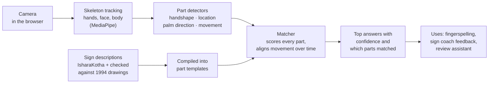

# Prism Sign: recognising signs from their description

As of 2026-11-20. A plan for recognising Bangla Sign Language (BdSL) signs without a large video
dataset. It extends [sign-language-plan.md](sign-language-plan.md), which put recognition in a later
research phase because BdSL video data is small.

## Summary

**Prism recognises a sign by checking its parts (handshape, location, palm orientation and
movement) against a written description of the sign, not by learning from thousands of videos.**

Every sign is a combination of a few parts from a small, closed set. A description such as
"flat hand at the forehead, moving down" can be checked against a live signer's hand and body
skeleton, even if nobody ever recorded that sign on video. Only the handshape step needs training
data, and the set of handshapes is small.

Prism already has written descriptions of about 3,850 BdSL words (the IsharaKotha corpus), and two
drawn references to check them against. That turns BdSL's biggest weakness, too little video, into
the project's technical edge.

The same part-by-part check gives feedback a learner can act on: *"Your handshape is right; move
your hand down to your chest."* This makes it the engine for a parent sign coach as well as for
recognition.

## What we have

| Source | What it is | Size | Use |
| --- | --- | --- | --- |
| IsharaKotha corpus (`data/isharakotha`, not committed) | Machine-readable sign descriptions in HamNoSys notation (SiGML files), grouped in 31 topic sections | 3,990 files, about 3,850 unique words, 37 letters, a few full sentences; 83 files fail to parse | **Main description source** |
| Bengali Sign Language Dictionary, 1994 (Bangladesh Sign Language Committee, with deaf members) | Scanned line drawings with movement arrows, Bangla and English labels, 26 topic sections, one-hand and two-hand alphabets | 175 pages, about 900 signs (estimate) | Checks the descriptions; adds signs; reference for reviewers |
| Grameenphone "বাংলা ইশারা বর্ণ পরিচয়" (2026) | Clean drawings of the two-hand Bangla alphabet | About 40 letter cards | Checks the alphabet is current; reference only (Grameenphone owns the artwork) |
| Prism's approved sign clips | Real signers, approved by deaf reviewers, with consent | Grows with use | **Test set**, and later fine-tuning |

### What the descriptions contain

Counted across the IsharaKotha files:

- **Handshapes:** 16 base shapes (flat hand, fist, index finger, two fingers, pinch, "C" shape and
  others), plus thumb modifiers.
- **Palm and finger direction:** about 27 symbols (palm up, down, left, right; fingers up, out…).
- **Locations:** about 44 symbols (forehead, nose, lips, chin, neck, shoulders, chest, stomach,
  parts of the other hand, and neutral space in front of the body).
- **Movements:** about 50 symbols (straight moves in each direction, arcs, circles, finger play,
  repeats, "replace" for a change of handshape, and "no motion").
- **Two hands:** about 63% of files describe two-handed symmetric signs.
- **Not covered:** facial expressions and mouth patterns appear in only 158 files, and speed and
  rhythm are barely described.

### Coverage

Everyday and health words are well covered (water, sun, fire, tree, food, fever, doctor, hospital,
medicine, love, eat, sleep, teacher, school, book). Lesson-specific science words are mostly
missing (air, leaf, plant, heat, energy, oxygen). Those still come from the community lexicon in
the existing plan. Each new approved clip can also get a description, so the recogniser grows with
the lexicon.

## How it works

1. **Skeleton tracking.** MediaPipe runs in the browser and gives 21 points per hand plus face and
   body points, many times a second. Video never leaves the device; only these points are used.
2. **Part detectors**
   - **Handshape:** a small classifier over finger joint angles, choosing one of the 16 base
     shapes plus thumb variants. This is the only trained model.
   - **Location:** where the hand is relative to the face and body points (forehead, chin, chest…),
     scaled to the signer's body size.
   - **Palm and finger direction:** computed from the hand points, no training needed.
   - **Movement:** the path of the hand over time, simplified into strokes (down, arc, circle,
     repeat).
3. **Sign descriptions.** A parser turns each SiGML file into a template: a start pose (handshape,
   orientation, location for each hand), then a sequence of movements and handshape changes.
4. **Matcher.** Each part gets a score, and the movement sequence is aligned in time (dynamic time
   warping) because people sign at different speeds. The result is the top few signs with an
   overall confidence and a per-part breakdown.
5. **Explanation.** The answer says what matched and what did not, for example *"জ্বর (fever):
   handshape ✓, forehead ✓, downward movement ✓, 87%"*. Low confidence means "not sure", never a
   guess.

### Training the handshape classifier

The 16 handshapes are few and static, so they need little data:

- The team records each handshape from several angles (a few seconds each), turned into skeleton
  points only.
- Synthetic variants: rotate, scale and slightly bend the recorded hand skeletons.
- Later, handshapes taken from approved, consented clips in the lexicon.

## Where it shows up in Prism

- **Fingerspelling:** sign a word letter by letter (two-hand Bangla alphabet) and Prism types it.
  Useful wherever a term has no sign yet.
- **Sign coach for parents:** practise a sign and get feedback on the part that is wrong. This is
  the "Ma, I love you" idea from the planning discussion.
- **Review assistant:** when a signer uploads a clip for a term, Prism checks it against the
  documented description and tells the deaf reviewer whether it matches the established sign.
  The reviewer still decides.
- **Later:** students answering questions by signing single words in adaptive lessons.

## Phase 0 results (2026-11-20)

`backend/internal/signref` now reads every SiGML file leniently and parses its HamNoSys symbols into a
template: each hand's shape (with thumb, bends and per-finger bends), extended-finger and palm
direction, location (body site, side, contact, and the touching parts of each hand) and a list of
actions (move, arc, circle, handshape change, hold and others, with direction, size, contact, target
and simultaneous actions). `go run ./cmd/signtemplates` writes `templates.json`, `stats.json`,
`failures.json` and `report.md` to `data/isharakotha/` (not committed), and the API serves templates
at `GET /api/sign/templates?section=Letters` or `?words=জ্বর,fever`.

| Measure | Result |
| --- | --- |
| Corpus files | 3,990 |
| Parsed into templates | 3,926 (98.4%) |
| Complete (handshape, orientation and location) | 3,877 files, 3,602 unique words |
| Letters of the two-hand alphabet | 37 of 37 complete |
| Words with symbols the parser could not place | 3 |
| Files that cannot be read | 64: 39 empty, 25 placeholders with no sign |
| Words made of several signs | 1,909 |

Still open from Phase 0: mapping the 1994 dictionary pages to signs (the scan has no text layer
and no OCR tool is installed yet), and the licence check. Some words appear in more than one section
with different descriptions; both are kept as variants.

## Phase 1 status (2026-11-20)

Built, and checked with synthetic hands and in the browser; **not yet measured on real people**.

- **Fingerspell page** (`/fingerspell`): Spell (type a word letter by letter), Practise a letter
  (plain-language steps, a score for each part and feedback on the weakest part) and Record samples.
  A "Simulate" switch drives the whole page with computer-made hands when there is no camera.
- **Hand tracking:** MediaPipe Hand Landmarker in the browser. The WebAssembly runtime is served by
  the app (`scripts/copy-mediapipe.mjs`); the hand model loads from Google's model storage. Video
  stays on the device; only the 21 points per hand are used.
- **Letter matcher** (`frontend/src/lib/handsign`): no training needed. Each hand's shape is scored
  from finger bends, spread and thumb position (including the thumb and "bent" modifiers); direction
  from finger and palm vectors in the signer's frame; and the contact point from the two named
  hand parts. Parts are combined with a weighted geometric mean, contact weighted most. A stabiliser
  types a letter after it has been the confident best guess for most of the last 12 frames.
- **Recorded samples:** `POST /api/sign/samples` stores skeleton points and a 151-number feature
  vector per frame, with the signer's consent, and they can be deleted.
- **Python** (`ml/`): `prism_ml.train_letters` trains standardisation + logistic regression on the
  samples, reports accuracy on held-out signers, and writes `frontend/public/models/letters.json`,
  which the page blends 50/50 with the template matcher.

| Check | Result |
| --- | --- |
| Base handshapes from synthetic hands, 3 orientations each | all in the top 3; at most a few look-alikes |
| Letters from synthetic two-hand poses with noise | 37 of 37 top-1 |
| End to end in the browser (simulation) | types ক ল ম correctly; practice feedback works |
| Python training on synthetic recordings, held out by signer | runs and exports a model the browser accepts |

The synthetic results only show that geometry, scoring and plumbing are consistent with the
descriptions they were generated from. **Real accuracy is unknown until people record samples**:
real hands vary, MediaPipe struggles when hands overlap (as they do in these letters), and the
corpus descriptions may differ from how deaf people sign. Next: record at least 5 samples of every
letter from several people, ideally deaf signers, then run `train_letters` and report held-out
accuracy against the 90% target.

## Phase 2 status (2026-11-20)

Built, and checked with synthetic signers and in the browser; **not yet measured on real people**.

- **Demo vocabulary:** 43 words in `frontend/src/lib/handsign/words.ts` (health 10, school 12, daily
  life 10, people and feelings 8, questions 3), 60 variants in the corpus. Most family words (mother,
  brother, sister, home) and yes/no are not in the corpus: they need the community lexicon.
- **Body tracking:** MediaPipe Pose (lite) runs beside hand tracking. `body.ts` places every
  HamNoSys body site (forehead, eyes, nose, mouth, chin, neck, shoulders, chest, stomach…) from the
  face and shoulder points, in shoulder widths, in 2D (pose and hand depth estimates do not share
  a scale).
- **Expected paths:** `motion.ts` turns each sign into keyframes: where each hand should be, its
  shape and direction, through moves, arcs, circles, handshape changes, wiggles and repeats.
  Mirrored two-hand signs move the other hand the opposite way; parallel ones move it along.
- **Matcher:** `words.ts` aligns a signing with each word's keyframes by dynamic time warping and
  scores handshape, starting place, movement, direction and the other hand. It explains the result
  and names the weakest part for the coach. A segmenter cuts signs from the stream (hand raised above
  the waist, then dropped). Scoring all 43 words takes about 1.4 ms.
- **Sign words page** (`/signs`): Recognise, Practise a word (step-by-step instructions and
  feedback) and Record samples (hand and body points, never video). A simulation mode signs words
  with computer-made signers.
- **Python:** `prism_ml.train_words` keeps a few prototype recordings per word, measures held-out
  accuracy and writes `frontend/public/models/words.json`; the browser uses the same alignment
  distance (checked to match Python exactly) and blends it 50/50.

| Check | Result |
| --- | --- |
| 60 word variants from synthetic signers | 60 of 60 top-1 |
| Heavier noise (0.06 / 0.1 shoulder widths) | 59/60 and 52/60 top-1; 60/60 and 58/60 top-3 |
| Signed 0.6 shoulder widths too low | 39/60 top-1: location matters, as it should |
| In the browser (simulation) | recognises জ্বর, বই, পানি, ধন্যবাদ; practice feedback works |
| Python word model on synthetic recordings, held out by signer | runs; exported model loads in the browser |

Two findings that changed earlier work:

- **HamNoSys palm codes are relative to the finger direction.** 41% of corpus poses had the palm
  "facing" the way the fingers point, which no hand can do. Read as HamNoSys intends (the palm as if
  the fingers pointed forward, then turned with them) every pose becomes possible: জ্বর (fever) is a
  hand laid on the forehead, palm toward the signer. `palmVector` in `hand.ts` applies this
  everywhere: letters, words, instructions and synthetic hands.
- **Bangla text is now Unicode NFC everywhere** (corpus names, term labels, lesson text). ো can be
  written as one code point or two; three demo words did not match until this was fixed. The same
  bug would have stopped some glossary signs from appearing in lessons.

## After the first real test (2026-11-20)

A first test with a real camera was inaccurate. No samples were recorded, so the cause could not be
read from data; three changes followed:

- **Handshapes were too sensitive to camera jitter.** Finger curl is now measured over the longer
  middle-knuckle-to-tip line, and hand points are smoothed over time (live, and across a recorded
  signing). With webcam-level jitter in synthetic tests, handshapes went from 68% to 90% correct and
  words from 52/60 to 60/60; the correct word's handshape score from 26% to 74%.
- **Hands are told apart by the body**, not by the hand model's left/right label, which is unreliable
  with one hand in view: each hand belongs to the nearer wrist of the body tracker. A "Swap hands"
  switch is there if it still goes wrong.
- **"Show what Prism sees"** gives a live readout of which hand is the signing hand, its shape,
  direction and nearest body site, and `frontend/scripts/analyze-samples.ts` re-scores recorded
  samples and shows which part fails per letter or word.

**The next step needs real recordings:** a few samples of each letter and word from the Record
samples tabs, then `node scripts/analyze-samples.ts --api http://localhost:8080`.

## Phase 3 status (2026-11-20)

- **Review assistant:** in Sign glossary → Deaf review, "Compare with the documented sign" tracks
  the uploaded clip in the browser (`trackClip` in `src/lib/handsign/mediapipe.ts`) and compares it
  with the term's IsharaKotha description, part by part, or by handshape and direction alone when the
  body is not in view. It advises; the deaf reviewer decides.
- **Demo readiness:** every page fits a 375-pixel phone screen; the demo script with fallbacks is in
  [demo-script.md](demo-script.md).
- **Not done:** the models still load from Google's servers (no offline copy), and the demo has not
  been rehearsed with a deaf signer.

## Phase 4 status (2026-11-20): the whole corpus and community signs

- **Signs shared by several words.** 37% of the corpus's words share an identical sign with another
  word (e.g. স্কুল and বিদ্যালয়, both "school"); form alone cannot tell them apart. Each distinct
  sign is now scored once and the result lists every word it can mean ("the same sign also means…").
- **The whole corpus.** A cheap start-and-end check narrows about 2,900 distinct signs to 120 before
  full alignment. On synthetic signers: top-1 98% (counting shared signs), top-3 100%, 62 ms per
  sign instead of 430 ms.
- **Signs learned from community clips.** When a deaf reviewer approves a key-term clip, the browser
  tracks it and writes the sign down as a template (`derive.ts`): handshape, starting place,
  direction, movement and the other hand. It is stored with the term (`sign_derived`, removed if the
  clip is rejected or withdrawn) and shown to the reviewer in plain words. The same matcher then
  recognises it, so terms the corpus lacks, such as ক্লোরোফিল (chlorophyll), become recognisable.
  Learned from one synthetic signer, a sign recognises another 58/61 top-1, 60/61 top-3.
- **Choosing the vocabulary.** Sign words can recognise the demo words, all documented words
  (about 3,500, sent gzip-compressed), or one lesson's key terms (documented and learned signs).
- **Corpus names** with underscores are cleaned ("প্রশ্ন_চিহ্ন" is "প্রশ্ন চিহ্ন"; an appended English
  gloss becomes the English name).

Still to do: measure all of this on real signers; learned templates come from one clip each, so
several approved clips per term should be combined.

## Phases

| Phase | Goal | Done when |
| --- | --- | --- |
| **0. Data** (Nov 21–24, mostly done Nov 20) | Parse all SiGML into part templates; list and fix the files that fail; map 1994 dictionary pages to their signs; check the description licences | Templates for at least 3,700 words, and a list of known gaps |
| **1. Fingerspelling** (Nov 25–30; built Nov 20, accuracy not yet measured) | Handshape classifier; recognise the 37 letters of the two-hand alphabet live in the browser | At least 90% letter accuracy on the team's own recordings; demo for the "Zero to Launch" submission |
| **2. Single signs** (Dec 1–20; built Nov 20, accuracy not yet measured) | Location, direction and movement detectors; matcher with explanations for 30–50 chosen signs (health, family, school) | Correct sign in the top 3 at least 80% of the time on held-out recordings by people who did not build it, ideally deaf signers |
| **3. Congress demo** (Dec 26; review assistant and demo script built Nov 20) | A parent practises signs and gets part-by-part feedback; fingerspelling; review assistant on one clip | Runs live on a laptop and a mid-range phone |
| **4. After the Congress** | Grow to hundreds of signs; tune templates with approved clips; real signers' variation; pilot with deaf partners | Accuracy reported per sign and per part on a public test set built with deaf partners |

## How success is measured

- **Letter accuracy** for fingerspelling, and **top-1 and top-3 accuracy** for signs, always on
  people who were not in the training data.
- **Accuracy per part** (handshape, location, direction, movement), to show where errors come from.
- **Calibration:** when Prism says 80% sure, it should be right about 80% of the time.
- **Coach usefulness:** do parents' signs get closer to the description after feedback? Rated by
  deaf reviewers.
- **Fairness:** accuracy across left- and right-handed signers, skin tones, lighting and cameras.

## Risks

| Risk | Mitigation |
| --- | --- |
| Descriptions miss speed, repetition, facial grammar and depth | Use them for single signs and fingerspelling first; add facial features only where a description has them; measure the gap honestly |
| IsharaKotha signs differ from what deaf people use, or from the 1994 dictionary | Check each sign in the demo set against the dictionary drawing and with a deaf reviewer; keep regional variants as separate templates |
| Similar signs differ by one small part | Report the top 3 with explanations; teach the coach to point at the differing part |
| Skeleton tracking fails with fast or overlapping hands, poor light or cheap cameras | Test on a range of phones; show "can't see your hands clearly" instead of guessing |
| Left-handed signers | Mirror the templates |
| Licence of the IsharaKotha corpus and 1994 dictionary unknown | Use them as internal references until the licences are confirmed; do not republish the drawings or files |
| Building recognition on top of an avatar corpus could be read as endorsing avatars | Prism never renders the descriptions as an animated signer; it only reads the part information |

## Ethics

- Only skeleton points are processed; video stays on the device.
- No avatars and no generated signing: the descriptions are used only to recognise and to explain.
- Deaf reviewers decide which descriptions count as correct BdSL, and their corrections become
  part of the templates.
- Test recordings by deaf signers need the same per-clip consent as the lexicon, and they are not
  used for training unless the signer agrees.

## Open questions

- [ ] What is the licence of the IsharaKotha corpus, and who maintains it?
- [ ] Can we get permission to use the 1994 dictionary drawings (Bangladesh National Federation of
      the Deaf, Department of Social Services)?
- [ ] Which 30–50 signs matter most for the demo: health, family and school words?
- [ ] Which deaf signers can record a small, consented test set before Dec 20?
